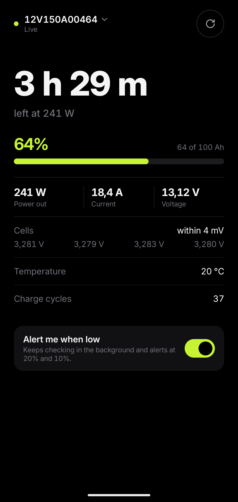

# jbd-bms-monitor

Android app and Python script that read live status from a LiFePO4 battery with a
JBD / Xiaoxiang Bluetooth BMS: charge, power, time to empty or full, cell voltages,
temperatures and protection alarms.



## Supported batteries

**Tested on:** VoltPolska / Sunwind 12V 100Ah LiFePO4 (shows up over Bluetooth as `12V150A…`).

**Should work with** any battery whose BMS is a JBD / Xiaoxiang. If the Xiaoxiang or
"Smart BMS" app can read your battery, or a Bluetooth scanner such as nRF Connect shows
service `FF00`, it's probably compatible. Tried it on another battery?
[Open an issue](../../issues/new?template=add-battery.yml) and it'll be added here.

## Android app

Requires Android 12 or newer. Install it with [Obtainium](https://obtainium.imranr.dev)
by adding `https://github.com/andriykohut/jbd-bms-monitor`, which also keeps it
updated, or download the APK from [Releases](../../releases). Open the app and pick
your battery from the list.

- Live readings every 2 seconds while the app is open.
- "Alert me when low": an ongoing notification with the charge, polled once a minute,
  and an alert when the charge falls to 20% and 10%. Between polls the app lets go
  of the battery, so another phone can connect to it.
- Several batteries can be added and switched between.

Build it yourself with `cd android && ./gradlew assembleRelease`. Without a
`keystore.properties` the release APK is unsigned.

To release, bump `versionCode` and `versionName` in `android/app/build.gradle.kts`
and push a matching tag (`v0.2.0` for `0.2.0`). CI builds the signed APK and
attaches it to a GitHub release.

## Python script

Prints one reading from the first JBD BMS it hears:

```sh
uv run battery.py
```

## Protocol

The BMS advertises service `FF00`. Requests are written to characteristic `FF02`
and replies arrive as notifications on `FF01`. Command `0x03` returns pack voltage,
current, charge, capacity, cycles, temperatures and protection flags; `0x04` returns
cell voltages. The decoder lives in [`battery.py`](battery.py) and
[`Bms.kt`](android/app/src/main/java/dev/andrii/battery/Bms.kt).

Some batteries now and then answer with a well-formed reply full of nonsense (such as
2.56 V across 32 cells); both decoders reject a reading whose pack voltage doesn't
match the sum of its cells.

## Tests

```sh
uv run --with bleak test_battery.py
cd android && ./gradlew test
```

## License

[MIT](LICENSE). The bundled Inter font is under the
[SIL Open Font License](android/app/src/main/res/raw/inter_ofl.txt).
